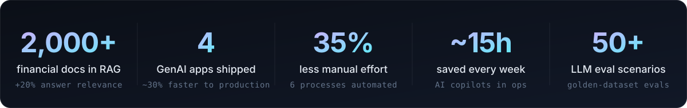

<div align="center">



<br/>

<a href="https://github.com/khushita28">
  
</a>

<br/><br/>

<a href="https://www.linkedin.com/in/khushita-joshi/"></a>
<a href="mailto:khushitaajoshii@gmail.com"></a>


</div>

<br/>

### ✦ About

I'm a **Forward Deployed AI Engineer** who sits between the business and the model. I learn how a team actually works, find the steps where AI earns its place, and ship the system end to end.

Right now that means **RAG, multi-agent workflows and AI copilots for banking and operations teams at JPMorgan Chase**. Before that I built ML and NLP models at Hexaware and enterprise workflow software at Newgen, so I've seen the stack from Java services and SQL tuning up to LLM evaluation.

- 🎓 &nbsp;M.S. Computer Science, **Worcester Polytechnic Institute** (2025)
- 🏅 &nbsp;**Claude Certified Architect, Professional**
- 🧭 &nbsp;5+ years across software engineering → machine learning → enterprise GenAI

### ✦ Impact at a glance



### ✦ What I build

<table>
  <tr>
    <td width="50%" valign="top">🔎 &nbsp;<b>Retrieval-augmented generation</b><br/><sub>Ingestion, embeddings, vector search and grounded answers over large document sets.</sub></td>
    <td width="50%" valign="top">🕸️ &nbsp;<b>Multi-agent systems</b><br/><sub>Stateful LangGraph workflows, MCP tool calling, conditional routing and agent coordination.</sub></td>
  </tr>
  <tr>
    <td width="50%" valign="top">🤝 &nbsp;<b>AI copilots & automation</b><br/><sub>Copilots that take the repetitive work out of document review, extraction and ops queries.</sub></td>
    <td width="50%" valign="top">🧪 &nbsp;<b>LLM evaluation & responsible AI</b><br/><sub>Golden datasets, automated evals, observability and the controls model-risk teams ask for.</sub></td>
  </tr>
</table>

### ✦ Toolkit

<p>
  
</p>

**GenAI & agents** &nbsp;


**ML & data** &nbsp;


**Apps, data & delivery** &nbsp;


### ✦ Selected work

| Project | What it does | Stack |
|:--|:--|:--|
| 🧳 **TripPlanner** <br/><sub>multi-agent travel assistant</sub> | Research, travel and writer agents turn one question into a full itinerary with weather, events and live flights. Benchmarked GPT-3.5, LLaMA and Gemini on tool-calling reliability and cost. | TaskflowAI · OpenAI · Groq · Streamlit · Docker · AWS |
| 📨 **Email Intent Routing** <br/><sub>LangGraph workflow</sub> | Async graph that classifies inbound email and routes invoices to AP, with injection-resistant prompts, confidence scores and mocked-SDK unit tests. | LangGraph · Python · pytest |
| 📄 [**PDFQuery_LangChain**](https://github.com/khushita28/PDFQuery_LangChain) | Ask questions of any PDF: chunking, embeddings and retrieval over a vector store. | LangChain · Astra DB |
| 🩺 [**Ultrasound Image Analysis**](https://github.com/khushita28/Ultrasound-image-analysis-Project) | Unsupervised anomaly detection on breast ultrasound images. | Python · Computer vision |

<sub>More repos are on the way. This section grows as they ship.</sub>

### ✦ Path so far

```text
2025 ─ now    Forward Deployed AI Engineer · JPMorgan Chase
2023 ─ 2025   M.S. Computer Science · Worcester Polytechnic
2022 ─ 2023   ML Engineer · Hexaware Technologies
2020 ─ 2022   Software Engineer · Newgen Software
```

### ✦ Built with AI, on purpose

This profile was designed and written alongside **Claude Code**: the banner, the stat card and this page are hand-built SVG and Markdown, iterated with an AI pair. That is how I like to work. I pick the problem, set the bar and review every line, and the model makes me faster. It is the same approach I bring to clients.

<br/>

<div align="center">
  
  <br/><br/>
  
</div>
